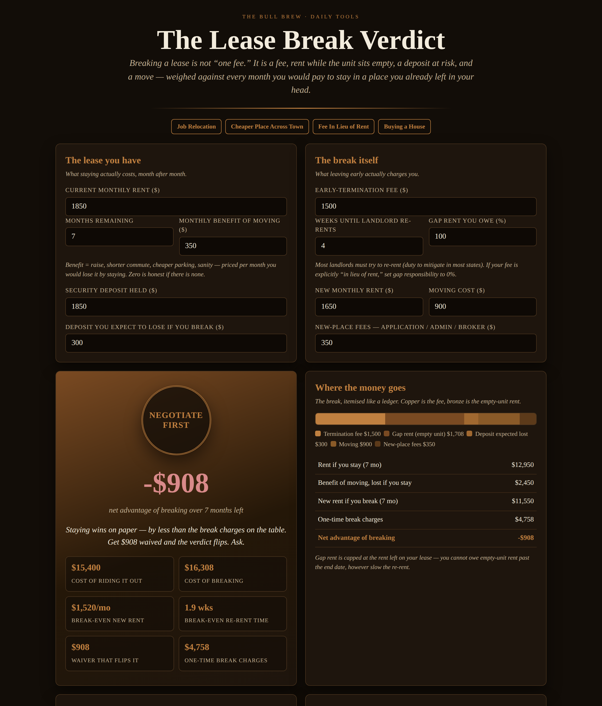

# The Lease Break Verdict — Break the Lease or Ride It Out?

**Live:** https://thebullbrew.github.io/lease-break-verdict/
**Repo:** https://github.com/thebullbrew/lease-break-verdict

## What it does

Prices an early lease exit honestly for renters: the termination fee, rent owed while the unit sits empty waiting to re-rent, deposit expected lost, moving costs and new-place fees on one side — against the full cost of riding out the remaining months, including the monthly benefit of moving (a raise, a shorter commute) that you lose for every month you stay. You get a BREAK IT / CLOSE CALL / NEGOTIATE FIRST / RIDE IT OUT seal, the net advantage of breaking over the months left, a break-even new rent, a break-even re-rent time, the exact waiver that would flip the verdict, a money-anatomy bar and itemised ledger, 0–12 week re-rent and 0–100% fee-waiver sensitivity tables, 4 presets (Job Relocation, Cheaper Place Across Town, Fee In Lieu of Rent, Buying a House), saveable cases, and a copyable summary. On the defaults it lands at NEGOTIATE FIRST, −$908 — get $908 of the break charges waived and breaking wins.

## The method

Stay cost = current rent × months left + monthly benefit of moving × months left. Break cost = one-time charges + new rent × months left, where one-time charges = termination fee + gap rent + expected deposit lost + moving + new-place fees. Gap rent = weekly rent (monthly × 12 ÷ 52) × empty weeks × your responsibility share, capped at the rent remaining on the lease — you cannot owe empty-unit rent past the end date. Set gap responsibility to 0% when your fee is explicitly in lieu of rent. Break-even new rent and break-even re-rent weeks are solved directly from the same equations, and the flipping waiver is simply the shortfall when breaking loses. Lease-break rules, mitigation duties and fee enforceability vary by state and by lease — general information, not legal advice.

## Design

Dark aesthetic variation 12 — Copper Ledger: warm copper numbers and rules on near-black brown, bronze borders, faint ledger lines behind the data rows, like an old account book under lamplight.

## How to run

Open `docs/index.html` in any browser, or serve `docs/` with any static host. Works offline as a PWA after first load. No backend, no accounts, no data leaves your device — saved cases live in localStorage.
